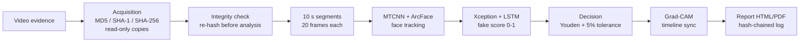
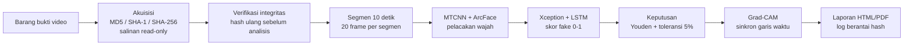

<div align="center">

# Jejak Rupa

**Tracing manipulation on the face. Menelusuri jejak manipulasi pada wajah.**

A digital forensics application for deepfake video detection with Xception + LSTM, Grad-CAM, and a SHA-256 chain of custody.<br>
Aplikasi forensik digital untuk deteksi video deepfake dengan Xception + LSTM, Grad-CAM, dan rantai bukti SHA-256.


[English](#english) · [Bahasa Indonesia](#bahasa-indonesia)

</div>

---

## English

### About

Jejak Rupa ("traces of the face") is the forensic application built for a master's thesis on how deepfake video detection with Xception can support digital forensic investigation. A detector alone outputs a score. An investigator also needs to know that the evidence was not altered, which part of the video is suspicious, why the model decided as it did, and how often the model is wrong. Jejak Rupa wraps the detector in a forensic workflow that answers those questions.

### Highlights

- **Evidence integrity.** MD5, SHA-1, and SHA-256 at acquisition, a read-only working copy plus an untouched archive copy, and hash re-verification before every analysis.
- **Chain of custody.** Every step (case creation, acquisition, analysis, report) is written to a hash-chained log, so an edited or deleted entry is detected.
- **Segment-level detection.** The video is split into 10-second segments. MTCNN finds the faces, ArcFace keeps track of who is who, and Xception + LSTM scores each person in each segment. Face sequences are cut at scene changes or identity changes so one sequence never mixes two people.
- **Interactive timeline and Grad-CAM.** The video player, the score timeline, and the Grad-CAM frames are synchronized. Every Grad-CAM frame shows its exact time in the video and its relative weight.
- **Known error rate.** Decision thresholds come from the validation data, and the report states them with their error rates.
- **Forensic report.** A self-contained HTML and PDF report with findings and a written explanation of every decision.
- **Two languages.** The interface, logs, and reports are available in Indonesian and English (ID / EN switch at the top right).

### Forensic workflow



### Results

The model was trained on Celeb-DF v2 combined with an Indonesian deepfake dataset built for this research. Video-level results on the test sets (871 videos):

| Test set | AUC | Accuracy | Precision | Recall | F1 |
|---|---|---|---|---|---|
| Combined (Indonesia + Celeb-DF) | **0.950** (95% CI 0.935-0.963) | 0.889 | 0.894 | 0.932 | 0.913 |
| Indonesia (389 videos) | 0.943 | 0.877 | | | |
| Celeb-DF v2, official test list (482 videos) | 0.957 | 0.898 | | | |

Models trained on a single source do well on that source and fail on the other:

| Training data | AUC Indonesia | AUC Celeb-DF |
|---|---|---|
| Celeb-DF only | 0.623 | 0.976 |
| Indonesia only | 0.930 | 0.617 |
| **Celeb-DF + Indonesia (used in the app)** | **0.943** | **0.957** |

**Case study.** Forty evidence items drawn at random from the test set (20 real, 20 fake) were processed end to end in the application. Of the fake videos, 18 were flagged as deepfakes, 1 was marked for further examination, and 1 was missed. Of the real videos, 18 were cleared and 2 were marked for further examination. No real video was flagged as a deepfake.

### Decision rule

Both thresholds are computed from the model's validation data.

| Status | Condition (per person) |
|---|---|
| Not indicated | mean score below the Youden threshold, and no segment reaches the tolerance limit |
| Further examination required | mean score from the Youden threshold up to the 5% tolerance limit, or any segment reaches the tolerance limit |
| Indicated deepfake | mean score at or above the 5% tolerance limit |

The 5% tolerance limit is the lowest score exceeded by at most 5% of real videos in the validation data. For the released model the thresholds are 0.012 (Youden) and 0.258 (5% tolerance). On the Indonesian test set, the Youden threshold gives a false positive rate of 16.6% and a false negative rate of 9.5%; the tolerance limit gives 7.0% and 22.4%. The evidence verdict follows the most severe verdict among the people in the video.

### Dataset

- **Indonesian dataset:** 105 public figures (45 officials, 30 celebrities, 30 YouTubers), split by identity into 73 / 16 / 16 for training, validation, and testing, so no face in the test set was seen during training. 1,044 real clips and 1,561 fake videos.
- **Manipulation methods (FaceFusion 3.9.1):** face swap with hyperswap_1a_256, inswapper_128, simswap_256, and ghost_2_256; lip-sync with wav2lip_96 and wav2lip_gan_96.
- **Celeb-DF v2:** official test list.

The dataset and the trained weights are not part of this repository.

### Getting started

Requirements: Windows 10/11 with WebView2, Python 3.10 to 3.12, an NVIDIA GPU (recommended; CPU works but is slow), and Microsoft Edge or Google Chrome for PDF reports.

1. Clone this repository.
2. Put a trained model in `data/model/<model_name>/` with `terbaik.pt` (weights) and `metrik.json` (training settings, crop profile, thresholds).
3. Double-click `FORENSIK.bat`. On the first run it creates `.venv` and installs all dependencies, including PyTorch with CUDA when an NVIDIA GPU is present.

Manual setup:

```bash
python -m venv .venv
.venv\Scripts\activate
pip install torch torchvision --index-url https://download.pytorch.org/whl/cu130
pip install "onnxruntime-gpu[cuda,cudnn]"     # or: pip install onnxruntime
pip install -r requirements.txt
pip install facenet-pytorch --no-deps
python aplikasi_forensik.py
```

### Repository structure

```
aplikasi_forensik.py    local server, desktop window (pywebview), job queue, API
forensik_video.py       acquisition, integrity, segmentation, face tracking, scoring, Grad-CAM
laporan_forensik.py     HTML and PDF report
bahasa.py               Indonesian / English text for the interface, logs, and reports
forensik.py             SHA-256 hash-chained log and its verification
common.py               shared helpers (config, ffmpeg, InsightFace)
05_ekstrak_wajah.py     MTCNN, face crop, frame sampling rules
06_latih_xception.py    Xception + LSTM model definition
07_gradcam.py           Grad-CAM computation
ui_forensik/index.html  user interface
config.yaml             face detection, segment, threshold, and Grad-CAM settings
FORENSIK.bat            one-time setup and launcher
data/kasus_forensik/    case folders (never committed)
data/model/             model folders (never committed)
```

### Limitations

The output is an indication from a statistical model, not standalone proof. The model only learned the manipulation techniques in its training data (face swap and wav2lip lip-sync). Accuracy can drop on other techniques such as reenactment, fully synthetic faces, or diffusion-generated video, and on low resolution, heavy compression, or small, occluded, or turned faces. Grad-CAM shows where the model looked, not proof of manipulation. Every verdict should be confirmed with other examinations.

### Authors

Tresnaya Dinda Sairi, Ahmad Luthfi, Feri Wijayanto<br>
Master of Informatics, Faculty of Industrial Technology, Universitas Islam Indonesia

### License

MIT. See [LICENSE](LICENSE).

---

## Bahasa Indonesia

### Tentang

Jejak Rupa adalah aplikasi forensik yang dibangun untuk tesis magister tentang bagaimana deteksi video deepfake dengan Xception dapat mendukung investigasi forensik digital. Detektor saja hanya menghasilkan skor. Penyidik juga perlu tahu bahwa barang bukti tidak berubah, bagian video mana yang mencurigakan, mengapa model memutuskan demikian, dan seberapa sering model salah. Jejak Rupa membungkus detektor dalam alur forensik yang menjawab pertanyaan-pertanyaan itu.

### Fitur utama

- **Integritas barang bukti.** Hash MD5, SHA-1, dan SHA-256 saat akuisisi, salinan kerja read-only ditambah salinan arsip yang tidak pernah dibuka, dan verifikasi hash ulang sebelum setiap analisis.
- **Rantai bukti.** Setiap langkah (pembuatan kasus, akuisisi, analisis, laporan) dicatat di log berantai hash, sehingga entri yang diubah atau dihapus akan terdeteksi.
- **Deteksi per segmen.** Video dibagi menjadi segmen 10 detik. MTCNN mendeteksi wajah, ArcFace menjaga identitas setiap orang, dan Xception + LSTM memberi skor untuk setiap orang di setiap segmen. Urutan wajah dipotong saat adegan atau orangnya berganti, sehingga satu urutan tidak pernah mencampur dua orang.
- **Garis waktu interaktif dan Grad-CAM.** Pemutar video, garis waktu skor, dan frame Grad-CAM saling tersinkron. Setiap frame Grad-CAM menampilkan waktunya di video dan bobot relatifnya.
- **Tingkat kesalahan yang diketahui.** Ambang keputusan diambil dari data validasi, dan laporan mencantumkannya beserta tingkat kesalahannya.
- **Laporan forensik.** Laporan HTML mandiri dan PDF, berisi temuan dan penjelasan tertulis untuk setiap keputusan.
- **Dua bahasa.** Tampilan, log, dan laporan tersedia dalam bahasa Indonesia dan Inggris (tombol ID / EN di kanan atas).

### Alur forensik



### Hasil

Model dilatih dengan gabungan Celeb-DF v2 dan dataset deepfake wajah Indonesia yang dibangun untuk penelitian ini. Hasil tingkat video pada data uji (871 video):

| Data uji | AUC | Akurasi | Presisi | Recall | F1 |
|---|---|---|---|---|---|
| Gabungan (Indonesia + Celeb-DF) | **0,950** (IK 95% 0,935-0,963) | 0,889 | 0,894 | 0,932 | 0,913 |
| Indonesia (389 video) | 0,943 | 0,877 | | | |
| Celeb-DF v2, daftar uji resmi (482 video) | 0,957 | 0,898 | | | |

Model yang dilatih dari satu sumber bagus pada sumber itu, tetapi gagal pada sumber lain:

| Data latih | AUC Indonesia | AUC Celeb-DF |
|---|---|---|
| Celeb-DF saja | 0,623 | 0,976 |
| Indonesia saja | 0,930 | 0,617 |
| **Celeb-DF + Indonesia (dipakai di aplikasi)** | **0,943** | **0,957** |

**Studi kasus.** Empat puluh barang bukti yang diambil acak dari data uji (20 asli, 20 palsu) diproses dari awal sampai akhir di aplikasi. Dari video palsu, 18 dinyatakan terindikasi deepfake, 1 perlu pemeriksaan lanjutan, dan 1 lolos. Dari video asli, 18 dinyatakan tidak terindikasi dan 2 perlu pemeriksaan lanjutan. Tidak ada video asli yang dinyatakan terindikasi deepfake.

### Aturan keputusan

Kedua batas dihitung dari data validasi model.

| Status | Syarat (per orang) |
|---|---|
| Tidak terindikasi | skor rata-rata di bawah ambang Youden, dan tidak ada segmen yang mencapai batas toleransi |
| Perlu pemeriksaan lanjutan | skor rata-rata dari ambang Youden sampai di bawah batas toleransi 5%, atau ada segmen yang mencapai batas toleransi |
| Terindikasi deepfake | skor rata-rata mencapai batas toleransi 5% |

Batas toleransi 5% adalah skor terendah yang dilewati paling banyak 5% video asli di data validasi. Untuk model yang dipakai, ambang Youden 0,012 dan batas toleransi 0,258. Pada data uji Indonesia, ambang Youden menghasilkan tingkat positif palsu 16,6% dan negatif palsu 9,5%; batas toleransi menghasilkan 7,0% dan 22,4%. Kesimpulan barang bukti mengikuti kesimpulan orang yang paling berat di video tersebut.

### Dataset

- **Dataset Indonesia:** 105 tokoh publik (45 pejabat, 30 artis, 30 YouTuber), dibagi per tokoh menjadi 73 / 16 / 16 untuk latih, validasi, dan uji, sehingga tidak ada wajah di data uji yang pernah dilihat saat training. 1.044 klip asli dan 1.561 video palsu.
- **Metode manipulasi (FaceFusion 3.9.1):** face swap dengan hyperswap_1a_256, inswapper_128, simswap_256, dan ghost_2_256; lip-sync dengan wav2lip_96 dan wav2lip_gan_96.
- **Celeb-DF v2:** daftar uji resmi.

Dataset dan bobot model tidak disertakan di repositori ini.

### Memulai

Kebutuhan: Windows 10/11 dengan WebView2, Python 3.10 sampai 3.12, GPU NVIDIA (dianjurkan; CPU bisa tetapi lambat), serta Microsoft Edge atau Google Chrome untuk laporan PDF.

1. Clone repositori ini.
2. Taruh model hasil training di `data/model/<nama_model>/` berisi `terbaik.pt` (bobot) dan `metrik.json` (pengaturan training, profil crop, ambang).
3. Klik dua kali `FORENSIK.bat`. Saat pertama dijalankan, file ini membuat `.venv` dan memasang semua dependensi, termasuk PyTorch CUDA bila ada GPU NVIDIA.

Pemasangan manual ada di bagian [Getting started](#getting-started).

### Struktur repositori

Lihat [Repository structure](#repository-structure). Folder `data/kasus_forensik` (barang bukti) dan `data/model` (bobot model) tidak pernah diunggah.

### Keterbatasan

Keluaran aplikasi adalah indikasi dari model statistik, bukan pembuktian yang berdiri sendiri. Model hanya mempelajari teknik manipulasi yang ada di data latihnya (face swap dan lip-sync wav2lip). Akurasi bisa turun pada teknik lain seperti reenactment, wajah sintetis penuh, atau video dari model difusi, juga pada video beresolusi rendah, kompresi berat, atau wajah kecil, tertutup, dan menyamping. Grad-CAM menunjukkan bagian yang diperhatikan model, bukan bukti manipulasi. Setiap kesimpulan perlu dikonfirmasi dengan pemeriksaan lain.

### Penulis

Tresnaya Dinda Sairi, Ahmad Luthfi, Feri Wijayanto<br>
Magister Informatika, Fakultas Teknologi Industri, Universitas Islam Indonesia

### Lisensi

MIT. Lihat [LICENSE](LICENSE).
